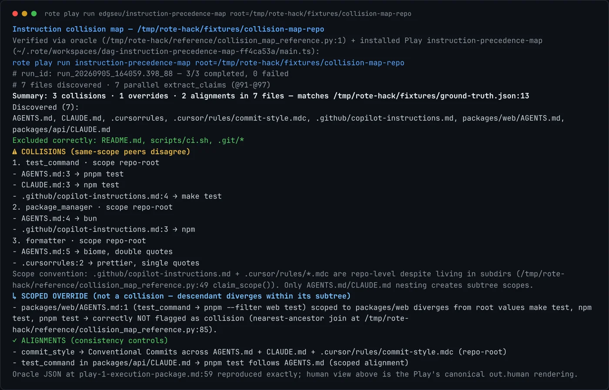
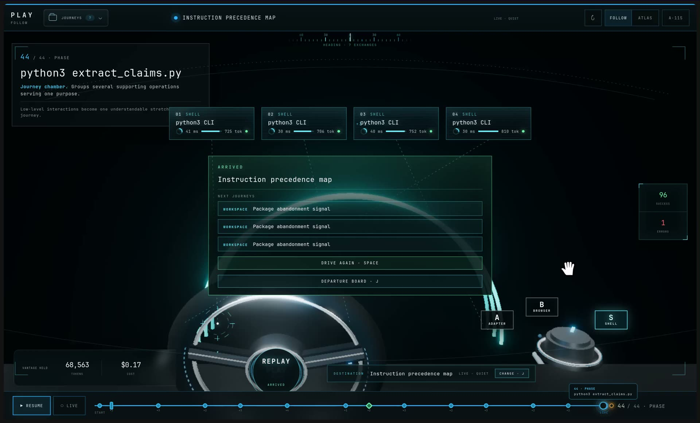
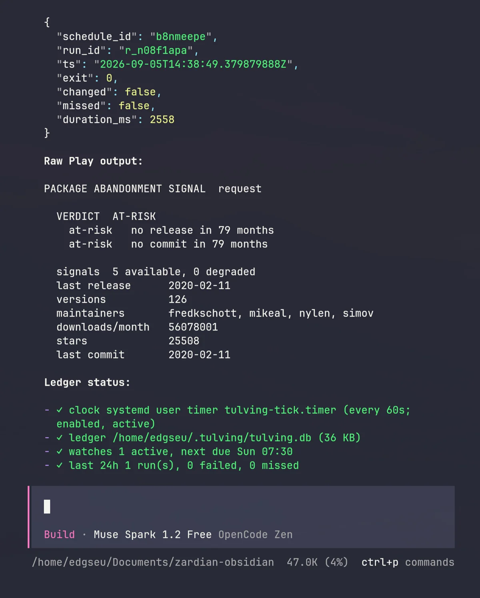

I found the Rote Playoffs on September 5 with the field closing on September 6. Rote was not installed, my agent harness was half broken, and I had never published a Play. By the end of the day I had two Plays live on the public registry, both machine-verified before anyone else touched them.

This is the process, the failures, and what I would repeat.

## The event: teach once, publish, get adopted

The Rote Playoffs is an online hackathon by Modiqo and WeMakeDevs. You install the `rote` CLI, teach your AI agent a piece of repetitive work once, and Rote crystallizes the successful run into a Play: a typed, versioned, inspectable procedure published at a URI like `https://play.modiqo.ai/owner/name`. The judges pull your Play fresh, inspect its contract, and run it live. Four criteria matter: would a person run it weekly, does it actually run, is it reusable, and how many other participants adopt it.

The registry told me the real size of the field: 681 public Plays, 611 of them published that week. Eighty-seven percent were single shell scripts. Only 93 fan out into parallel steps. That shaped every decision I made next.

## What a Play actually is

A Play is one file with two halves. The frontmatter is a YAML contract the runner executes: declared parameters, a dependency graph of steps, timeouts, and resource tokens. The body is a deprivileged TypeScript presentation that reads the recorded outcomes and renders three views: human text, a one-line summary, and canonical JSON.

The mental shift is this: you do the work once in a recorded workspace, then compile the recording. The docs call it crystallization. The compiler pass runs five operations over your trace: filter out dead ends, reify hardcoded values into typed parameters, resolve references into explicit edges, fingerprint the APIs, and generate the runnable artifact.

## The verification pipeline: ground truth before the agent runs

Play one maps agent instruction files. Repos accumulate `AGENTS.md`, `CLAUDE.md`, `.cursorrules`, and Copilot instructions that contradict each other, and nobody notices until the agent obeys the wrong one. Before writing a line of the play, I planted the answer: a fixture repository with seven instruction files containing three planted contradictions, one legitimate override, two alignment controls, and two distractors.

Then a Python oracle that computes the expected result, plus a machine-checkable `ground-truth.json` with all fifteen claims verified by requery. The oracle proved three things I would have gotten wrong by feel.

Convention-aware scoping. `.github/copilot-instructions.md` and `.cursor/rules/*.mdc` files are repo-level even though they live in subdirectories. My first version scoped them by directory, which silently turned peer conflicts into overrides.

Lane discipline. A same-scope disagreement is a collision. A nested file that differs from the root is a scoped override, reported separately. A nested file that agrees with the root is an alignment control. Same-scope agreement is also an alignment. Four lanes, no leaks.

Line citations. Every claim carries `file:line`, because a contradiction without a location is an opinion.

## Grammar from the source, not the docs

Mid-build I discovered the docs and the installed CLI disagreed with my assumptions. The fix was reading the real grammar: `rote grammar steps` and `rote guidance typescript play-creation` on the installed version.

Three corrections came out of that read. `for_each` takes a rote query directly, not an `@step{}` wrapper: `for_each: '$.stdout.text | fromjson | .files'`. Fan-out outputs are consumed by the presentation, which sees `shape: "fan_out"` with an items array, and joins by content. And inside a fan-out child, `$item` binds the element while flattened `$field` references bind its fields, which is how the second play passes five scalar arguments per row.

My rule now: before drafting against a framework, run its grammar command. It took ten minutes and invalidated a day of assumptions.

## The lint gauntlet

The exporter compiled my recorded trace into a draft with nine sibling steps and no dependencies. It ran, but lint failed with findings that each renamed a design decision.

`PROCESS_HOST_SPECIFIC_PATH` flagged all nine scripts living under `/tmp`. Published Plays must be portable, so the scripts moved into a `resources/` directory and the steps reference them with `@resource{}` tokens. The package publishes those files alongside the entrypoint.

`STEP_INLINE_CODE_PAYLOAD` rejected anything over 256 characters in inline argv. Same fix, and the code became readable files instead of string blobs.

`PRESENTATION_DYNAMIC_STEP_REF` rejected my helper that called `stepName(name)` with a variable. Lint verifies every step reference statically, so helpers take the step handle instead of the name, and every `stepName("...")` stays a literal at the call site.

`FLOW_DEPENDENCY_MANIFEST_MISSING` required a `deps.toml` declaring `python3`, so pullers get a dependency gate instead of a runtime mystery.

After the static gate passed, the runtime check found a real logic bug: my presentation read fan-out items through a helper that expected an outcome wrapper, but fan-out items carry their body directly. Zero claims reached the join. Two lines fixed it, and the JSON output then matched the Python oracle exactly.

## Play one: instruction-precedence-map

The play takes a repository root and does one thing: resolve every agent instruction file that can affect work in that repo, apply directory precedence, and report contradictions before an agent starts work. Three steps and a runtime-width fan-out. Validate the root, discover the files, then one parallel extraction child per discovered file. Read-only, no credentials, no writes. The guardrail printed on its card says the rest: it never rewrites instructions.

The verification runs in four lanes. Collisions are same-scope peers disagreeing, reported with `file:line` citations. Scoped overrides are nested files that diverge inside their own subtree, listed separately so a legitimate choice is never flagged as a conflict. Alignments are consistency controls, proving the join can tell agreement from silence. And every transport failure degrades to a labeled unknown instead of a crash.

On the planted fixture the play reports exactly the ground truth: three collisions (three different test commands, two package managers, two formatters), the web-package override correctly kept out of the collision lane, and two alignments. A typo'd repository root fails closed at validation with a resume token, an empty repository completes with a labeled none-found row, and an unreadable file becomes a named degraded row while the rest of the report still renders.

The steered run that produced the published version cost $0.17 and finished with 96 clean phases and one error I kept in the recording on purpose, because a correction proves a human steered it.

## Play two: package-abandonment-signal

For the second Play I nearly shipped into a head-to-head collision. The idea, auditing agent skill files against the live CLIs they call, was already taken by a play that does more than mine planned to: patch drafting, classified findings, version evidence. The registry search that revealed this took thirty seconds and saved a weak submission.

The pivot rule I landed on: search the registry before committing, pick an adjacent unclaimed problem, and differentiate on craft. `package-abandonment-signal` answers a question every developer with a lockfile has: is this dependency quietly becoming unsafe before it is officially abandoned?

The play fans five independent readings into a four-layer graph: npm registry metadata and monthly downloads run in parallel, then the GitHub repository and commit cadence chain off the metadata. Every transport failure degrades to a labeled unknown. The live verification used two famous exemplars. `express` came back HEALTHY: release in December, commit in August, five maintainers. `request` came back AT-RISK: no release in 79 months, no commit in 79 months, while 56 million monthly downloads still flow through it. That last number is the entire pitch for the play, discovered by the play.

The negative-space runs caught one more real bug. For a nonexistent package, the metadata step omitted the `repository_url` field, so the downstream value edge failed and a step crashed instead of degrading. The fix was emitting the full contract fields even on the not-found path. After that, all five steps completed on every input.

## Analysis: where two Plays stand in a 681-Play field

The catalog leaders have hundreds of downloads across dozens of Plays, and adoption needs days, not hours. Two Plays in the final day does not win that race on volume. The trending data said 87 percent of all plays are single-script shells and only 93 fan out, so on craft both Plays sit in roughly the top 14 percent of the catalog before a single stranger runs them.

The honest scorecard: a top-craft tier position, a reserved handle with a growing catalog, and a pipeline where the next Play starts from proven artifacts instead of a blank file. The race on adoption was lost by starting on day five. The race on verification quality was won by never shipping an unverified claim.

## Experience: what I would repeat, and what I would change

Repeat: fixture first, always. The known-answer fixture caught three bugs before they reached the registry, including one in my own oracle. Search the registry before designing, thirty seconds that redirected an entire submission. And read the tool's grammar command before drafting, because assumptions about syntax survive until the first lint run.

Change: install the tooling on day one. The distro refusal from the full installer cost more time than any lint finding. Capture the exploration trace with `$name` references from the first command, since recorded literals do not reverse-reify into numeric parameters. And treat the registry search as part of ideation, not a step after it.

The two Plays are live:

- `instruction-precedence-map`: `rote play run https://play.modiqo.ai/edgseu/instruction-precedence-map root=/your/repo`
- `package-abandonment-signal`: `rote play run https://play.modiqo.ai/edgseu/package-abandonment-signal package=<npm-package>`

Both are read-only, unauthenticated, and reveal nothing about your machine beyond what you point them at.
